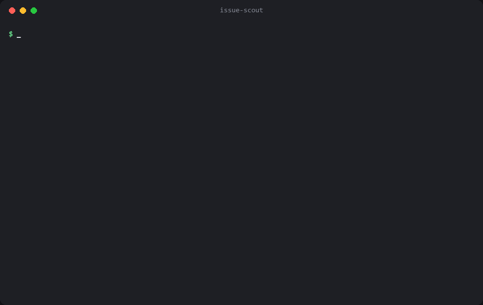
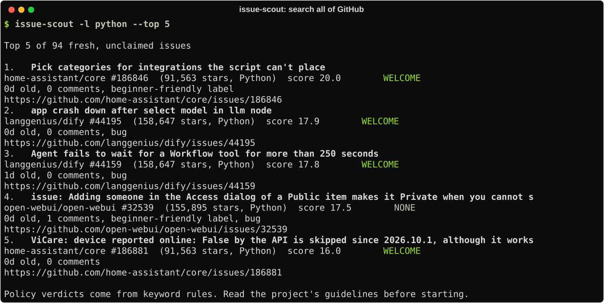
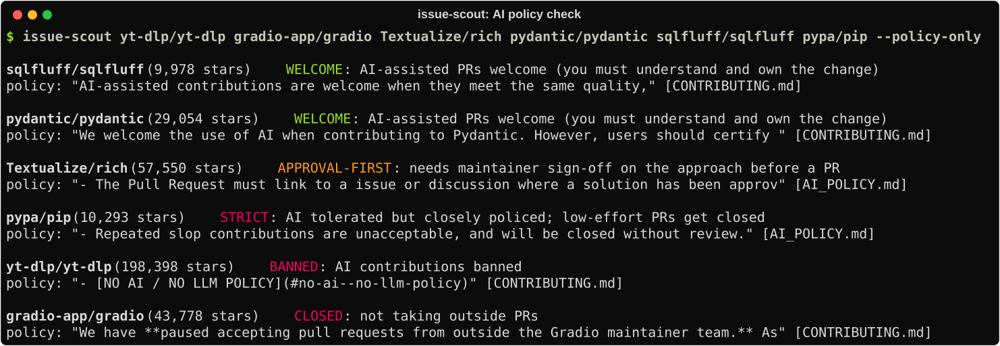
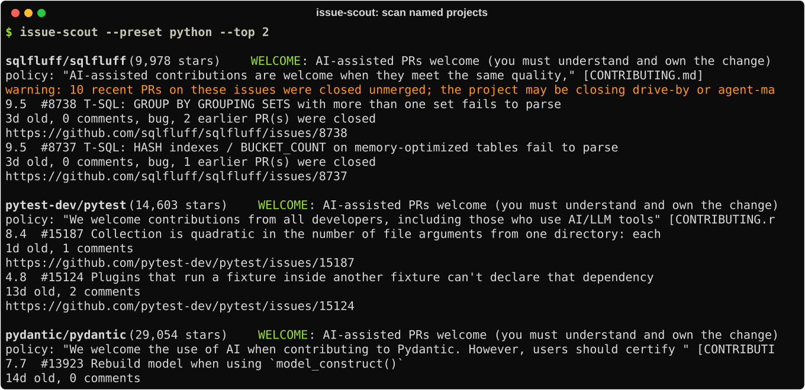
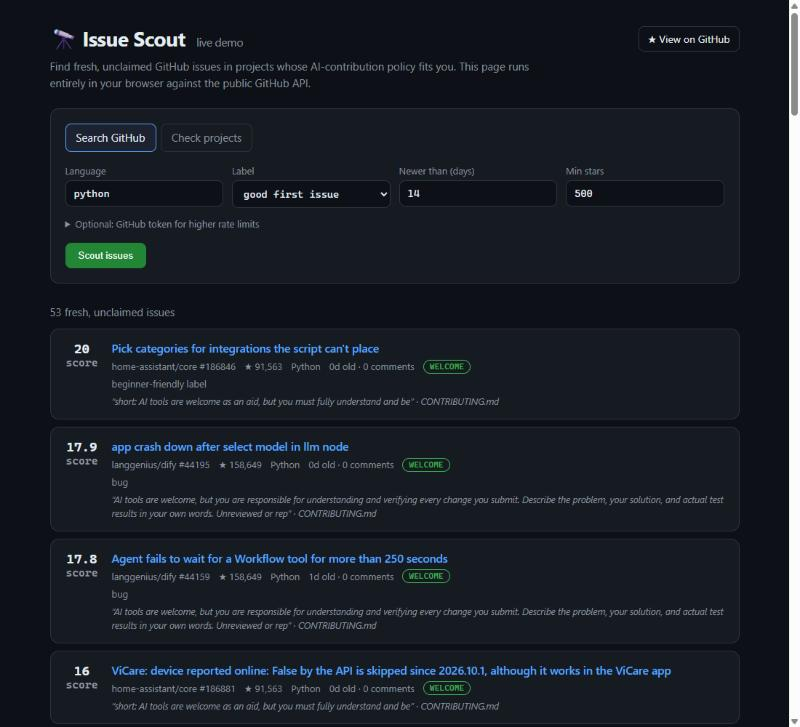
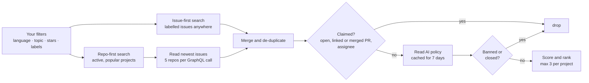

<div align="center">

# 🔭 Issue Scout

**Find fresh, unclaimed GitHub issues in projects that actually want your help.**

[](https://github.com/saihardhikreddy/issue-scout/actions/workflows/tests.yml)
[](pyproject.toml)
[](LICENSE)
[](https://saihardhikreddy.github.io/issue-scout/)
[](pyproject.toml)

[**Live demo**](https://saihardhikreddy.github.io/issue-scout/) ·
[Quick start](#-quick-start) ·
[Usage](#-usage) ·
[How it works](#-how-it-works) ·
[Claude Code skill](#-use-it-as-a-claude-code-skill)



</div>

## Why

Picking an open-source issue is now a race. On popular projects a fresh bug often gets two or
three pull requests within hours, and more and more projects close AI-assisted PRs, or ban them
outright. Issue Scout answers three questions before you write a line of code:

| | Question | How Issue Scout answers it |
| --- | --- | --- |
| 🆕 | **Is anyone already on it?** | Looks for open, linked and merged PRs and assignees, and flags issues whose earlier PRs were closed unmerged. |
| 🤖 | **Will the project accept my PR?** | Reads `AI_POLICY.md` and `CONTRIBUTING.*` (following symlinks), quotes the line that matters, and gives a clear verdict. |
| 📈 | **Which issue first?** | Ranks every candidate on one scale using freshness, labels, discussion, AI policy and project popularity. |

## ✨ Features

- **Searches all of GitHub.** It has no fixed list: it finds active, popular projects by
  language, topic and stars, and also searches issues directly.
- **AI-policy aware.** It sorts each project into `WELCOME`, `APPROVAL-FIRST`, `STRICT`,
  `BANNED` or `CLOSED`, and hides projects that won't take your PR.
- **Spots PR floods.** It warns when a project keeps closing recent PRs, which often means
  agent-made or drive-by PRs get auto-closed.
- **Fast and polite to the API.** It reads several repositories per GraphQL request, in
  parallel, caches policies for a week, and backs off on rate limits. A full search takes under a minute.
- **No dependencies.** It's pure Python plus the GitHub CLI you already use.
- **Two front ends.** It runs as a CLI with text or `--json` output, and as a
  [live web demo](https://saihardhikreddy.github.io/issue-scout/) that runs in your browser.
- **Claude Code skill included**, with guardrails that stop it opening PRs you haven't reviewed.

## 📸 Screenshots

<table>
  <tr>
    <td width="50%"><b>Search all of GitHub</b><br></td>
    <td width="50%"><b>Check projects' AI policies</b><br></td>
  </tr>
  <tr>
    <td width="50%"><b>Scan named projects</b><br></td>
    <td width="50%"><b>Live demo in the browser</b><br><a href="https://saihardhikreddy.github.io/issue-scout/"></a></td>
  </tr>
</table>

All screenshots come from real runs on October 16, 2026.

## 🚀 Quick start

**Try it without installing:** open the [live demo](https://saihardhikreddy.github.io/issue-scout/).

**Install the CLI.** You need Python 3.10+ and the [GitHub CLI](https://cli.github.com/), logged in with `gh auth login`.

```bash
pip install git+https://github.com/saihardhikreddy/issue-scout
issue-scout -l python
```

## 🧭 Usage

```bash
issue-scout                                  # search all of GitHub
issue-scout -l python -l rust                # only these languages
issue-scout --topic cli --min-stars 2000     # by topic, bigger projects only
issue-scout --label "good first issue"       # only this label
issue-scout --label any --days 3             # any label, last 3 days
issue-scout --query "org:microsoft"          # any extra GitHub search qualifiers
issue-scout owner/repo other/repo            # just these projects
issue-scout --preset python --policy-only    # AI policies of popular Python projects
issue-scout -l go --json                     # machine-readable output
```

<details>
<summary><b>All options</b></summary>

| Option | Default | What it does |
| --- | --- | --- |
| `-l`, `--language` | all | Repository language (repeatable) |
| `--topic` | none | Repository topic (repeatable) |
| `--label` | good first issue, help wanted, bug | Issue labels to search (repeatable, `any` for none) |
| `--min-stars` | 500 | Skip smaller projects |
| `--days` | 14 (search), 30 (named repos) | Only issues newer than this |
| `--max-comments` | 2 | Skip issues that already have more discussion |
| `--repo-limit` | 60 | Active repositories to read in the repo-first search |
| `--search-limit` | 300 | Issues to pull from the issue-first search |
| `--strategy` | both | `repos`, `issues` or `both` |
| `--per-repo` | 3 | Most results from one project (0 for no cap) |
| `--top` | 25 (search), 5 per repo | Results shown |
| `--include-claimed` | off | Also show issues that have open PRs |
| `--all-policies` | off | Also show issues from `BANNED` and `CLOSED` projects |
| `--any-script` | off | Keep issues whose titles are mostly in non-Latin scripts |
| `--preset` | none | Built-in lists of popular projects: `python`, `js` |
| `--policy-only` | off | Only report each named project's AI policy |
| `--json` | off | Machine-readable output |
| `--color` | auto | `auto`, `always` or `never` |

</details>

### Policy verdicts

| Verdict | Meaning |
| --- | --- |
| 🟢 `WELCOME` | AI-assisted PRs are accepted. You still have to understand and own the change. |
| 🟡 `APPROVAL-FIRST` | A maintainer must approve the approach on the issue before a PR. |
| 🟣 `STRICT` | AI is tolerated, but low-effort or agent-driven PRs are closed, or the account is banned. |
| 🔴 `BANNED` | AI contributions are not allowed. Hidden by default. |
| 🔴 `CLOSED` | Not taking outside PRs, or archived. Hidden by default. |
| 🔵 `MENTIONS-AI` / `NONE` | No clear rule was found, so read the contributing guide yourself. |

> [!NOTE]
> Verdicts come from keyword rules. Treat them as a pointer and read the quoted line before you start.

## 🔍 How it works



**Ranking.** Each issue starts at 10 points. It loses points for age (up to 10 at 60 days), for
comments, for looking like a discussion or feature request, for labels that need a maintainer
decision, and for earlier PRs that were closed unmerged. It gains points for beginner-friendly
and bug labels, a welcoming AI policy, and the project's popularity.

## 🤖 Use it as a Claude Code skill

Copy [`skills/issue-scout`](skills/issue-scout/SKILL.md) into `~/.claude/skills/` (or your project's `.claude/skills/`).
Then ask Claude something like *"find me a Python issue I can contribute to"*. The skill tells Claude to:

- respect each project's AI-policy verdict,
- re-check that an issue is still free before writing code, and
- never open a pull request until you've reviewed the change yourself.

## 🛠️ Development

```bash
git clone https://github.com/saihardhikreddy/issue-scout
cd issue-scout
pip install -e . pytest
python -m pytest
```

The live demo is a single static page at [`docs/index.html`](docs/index.html), served by GitHub Pages.

## 📄 License

[MIT](LICENSE)
